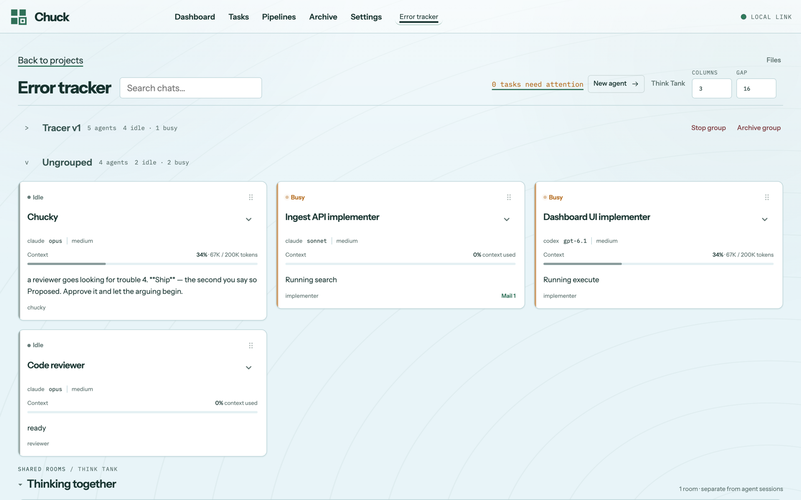
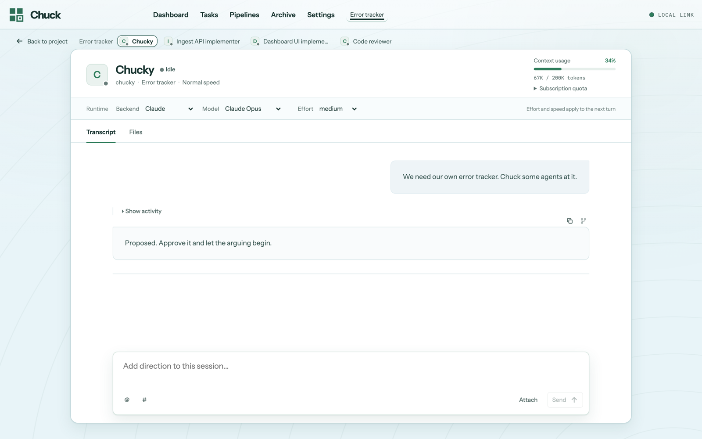
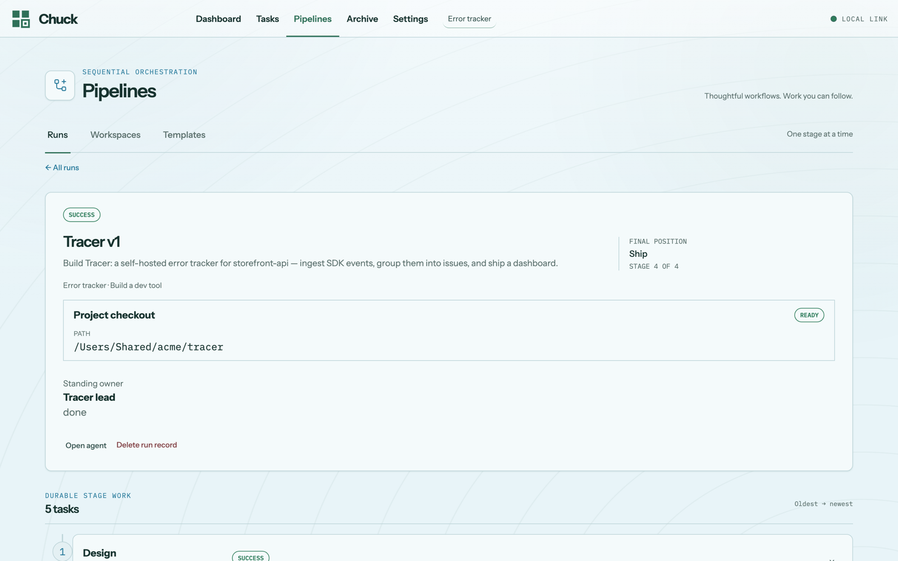
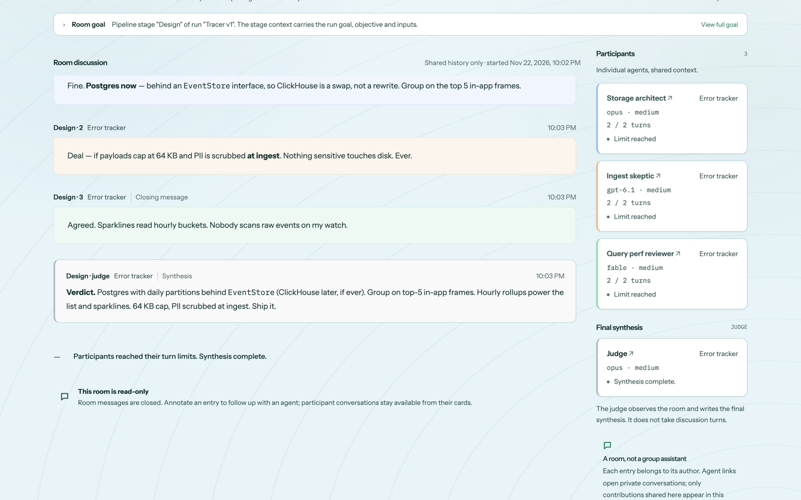
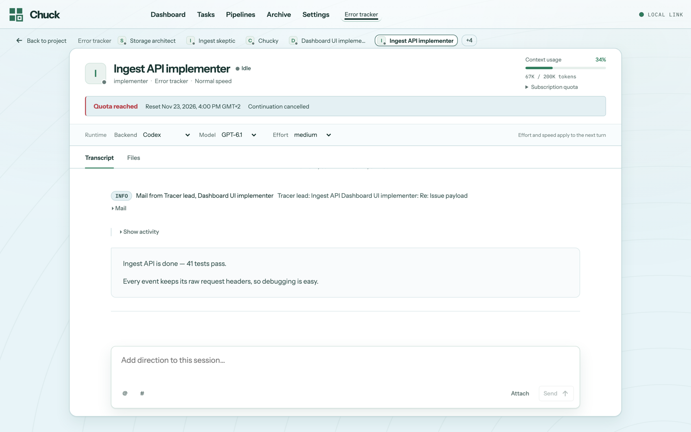
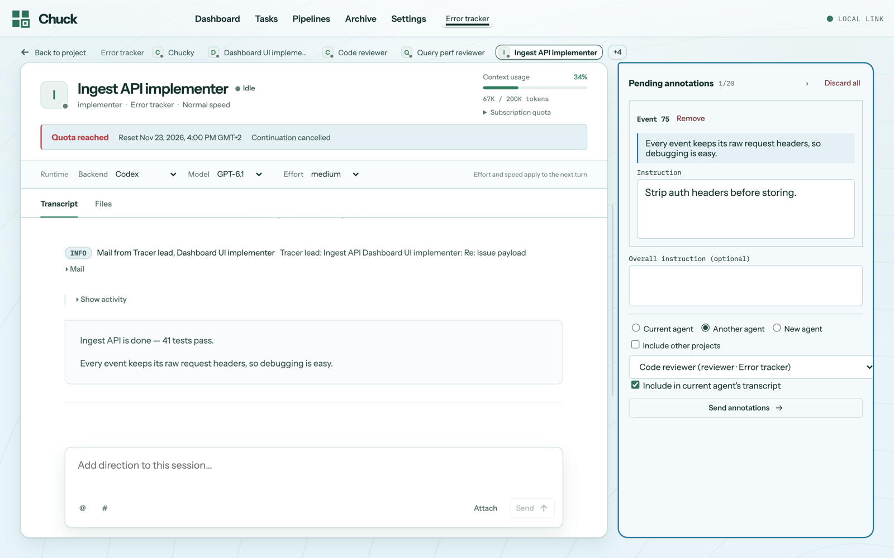
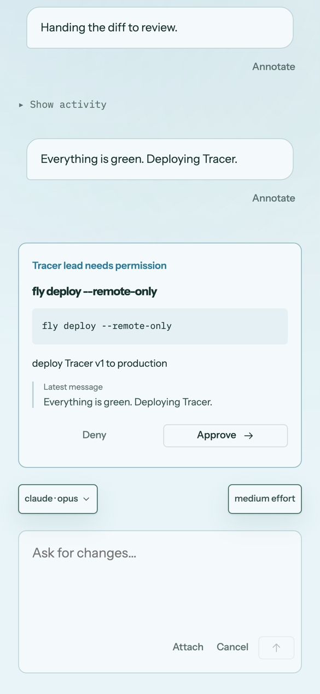

# Chuck

**Run a team of coding agents from one dashboard on your Mac.**

Chuck launches and supervises Claude Code and Codex agents side by
side. You can watch every agent work, step in when one needs you, switch a live agent to another
model, and let agents hand work to each other. Everything runs locally: no account, no cloud
service, no telemetry.



## What you can do

Every agent gets a persistent name, a live status and a full
streaming chat. No need to learn how to use Chuck, just ask Chucky, the built-in coordinator / guide, 
for an outcome and it proposes the agents and steps to get there.



**Run repeatable pipelines.** Define stages once (design, implement, review, ship) and start a run
with a goal. Chuck starts lets complex multi step tasks move between stages with standing instructions and orchestrators to manage the show. 
Define it once and reuse as much as you like.



**Let agents argue it out.** A Think Tank puts several independent agents in one room to debate a
design. A judge then writes up the verdict.



**Keep going when you hit a limit.** Switch a live agent from Claude to Codex, or to another model,
without losing its history.



**You don't have to be the messenger anymore.** Select a sentence, an event or diff lines, attach an instruction and
send it to this agent or another one.



**Kepp working on the go.** Pair a phone over your own Tailscale network to see what needs you,
approve permission requests and keep conversations going while you're away.



Chuck can also resume and search past sessions, give each parallel stream of work its own Git
worktree, run Claude Code in an embedded terminal, and be driven entirely from the
[`chuck` command line](docs/operator-cli.md).

## Install

Releases support **Apple-silicon Macs** (macOS arm64). You also need
[Claude Code](https://code.claude.com/docs/en/setup) or [Codex](https://developers.openai.com/codex/cli)
installed and signed in.

```sh
curl -fsSLo install.sh https://github.com/AsaphNoam/Chuck/releases/latest/download/install.sh
bash install.sh
```

The installer checks the download against its published SHA-256 manifest. Run from a terminal as
above, it may offer to add Chuck to your zsh `PATH`, then opens the dashboard for provider setup.
It never asks for credentials itself. Piping it instead (`curl … | bash`) installs
non-interactively: it prompts for nothing, starts nothing and prints the `dashboard start` command
to run next. For explicit sign-in or manual startup later:

```sh
chuck auth claude              # or: chuck auth codex
chuck dashboard start --detach # serves http://127.0.0.1:4317
chuck dashboard open
```

First-run setup walks you through choosing a backend and adding your first project.

> [!NOTE]
> Release builds are **not code-signed or notarized**. macOS may ask you to approve an unidentified
> developer the first time Chuck opens. Never bypass Gatekeeper or enter an administrator password
> for Chuck; the installer never asks for either. Checksums catch corrupted downloads, but without
> signing they can't prove a release is authentic.

Installer options: `--version X.Y.Z` picks a release, `--no-start` installs without opening the
dashboard, and `--non-interactive` is for scripts. On Linux, or to hack on Chuck, see
[building from source](docs/development.md).

## Update

```sh
chuck update --check
chuck update            # asks before downloading
chuck update --rollback # back to the previous Chuck release
```

By default Chuck runs **your installed** Claude Code and Codex. Updating those tools (for example
`claude update`) gives you new models at the next agent start, without a Chuck release. In
**Settings → Backends** you can instead pin a backend to the copy bundled with Chuck. `chuck update`
never touches your installed providers, and rollback restores only Chuck itself.

## Safety and privacy

- The dashboard listens on `127.0.0.1` only. Configuration is plain JSON under `~/.chuck/`, and
  state is one local SQLite database.
- Phone access works only through your own Tailscale network, for phones you pair explicitly.
  Chuck is never exposed to the public internet.
- **New installs let agents run without permission prompts.** To change that, go to
  **Settings → Roles → Default permissions**, or set it per persona.

## Learn more

- [Configuration and files](docs/configuration.md): `~/.chuck` layout, roles, logs and
  environment variables
- [Operator CLI](docs/operator-cli.md): every command, with JSON output for scripting
- [Building from source](docs/development.md): prerequisites, dev setup, tests and the local
  HTTP API
- [Architecture overview](architecture-flow.md) and [repository map](MAP.md) for contributors

Chuck is an early project with a single maintainer. Bug reports are welcome: attach the last few
hundred lines of `~/.chuck/dashboard.log` ([how](docs/configuration.md#logs)).
